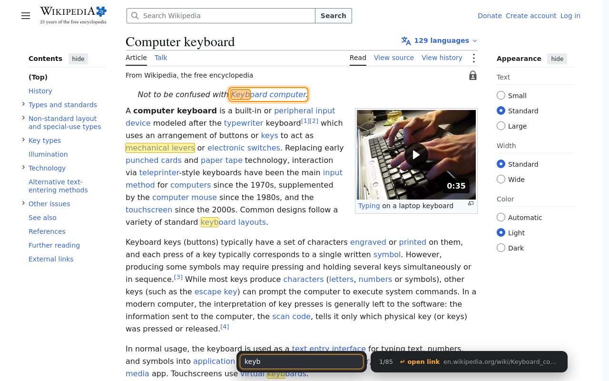
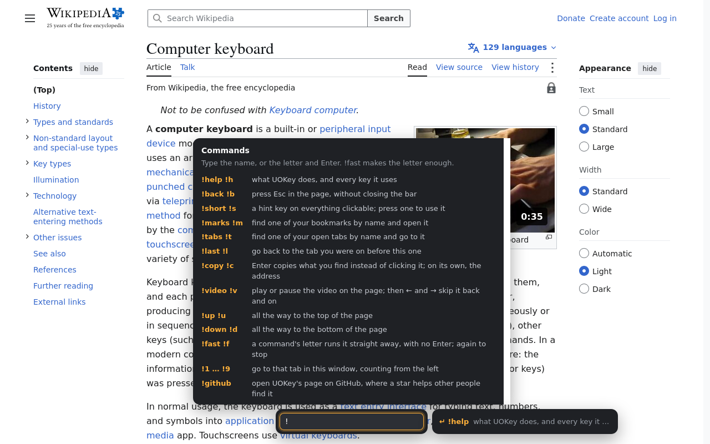
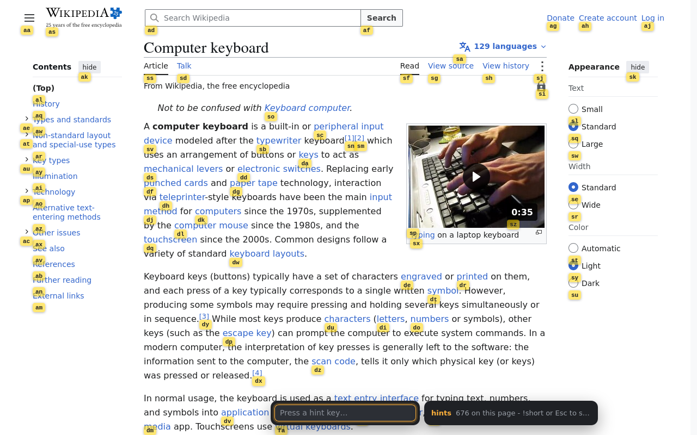

# UOKey

**Use Only Keyboard.** A Firefox add-on: press Ctrl+Space, type part of what a link, button
or field says, and press Enter to click it.

---

## Using it

Press <kbd>Ctrl</kbd>+<kbd>Space</kbd>. A small bar opens at the bottom of the page. Type part of
the text of a link, button or field - `searc` for Amazon's "Search Amazon" box. Every match is
highlighted, and <kbd>Enter</kbd> clicks the orange one; if it is a text field, Enter puts the
cursor in it instead, so you can type.

Beside the box: which match you are on out of how many, and what Enter will do to it. Nothing
else shows until you ask. The bar moves to the top of the page when it would cover the match.

| Keys | What they do |
| --- | --- |
| <kbd>Ctrl</kbd>+<kbd>Space</kbd> | open the bar, or back out of it |
| <kbd>Enter</kbd> | click the orange match, or start typing in it if it is a field |
| <kbd>Shift</kbd>+<kbd>Enter</kbd> | open a link, or a bookmark, in a tab behind this one |
| <kbd>Tab</kbd> or <kbd>↓</kbd> | next match |
| <kbd>Shift</kbd>+<kbd>Tab</kbd> or <kbd>↑</kbd> | previous match |
| <kbd>&lt;</kbd> and <kbd>&gt;</kbd> | nudge whatever the match sits in, or the page; hold to keep going |
| <kbd>PageUp</kbd> and <kbd>PageDown</kbd> | the same, a screen at a time |
| <kbd>Esc</kbd> | close the bar and go back to where you were |

It searches visible text, and also placeholders, labels, tooltips and image descriptions (alt
text), and whatever you have already typed into a field - so a search box you have half filled in
is found by your own words, not by the placeholder it has stopped showing. Passwords are left out:
what the screen stars out, UOKey does not read. Capitals and accents make no difference, so `οδος`
finds `Οδός`. Anything the page gives the hand cursor counts as clickable, which is how most of the
web builds a button out of a plain `div`.

> [!TIP]
> To use a different shortcut: `about:addons` → ⚙ → **Manage Extension Shortcuts**. Whatever you
> pick works on any keyboard layout. If Firefox's address bar has the keyboard when you press it,
> the bar says **Press F6 to type here**.

---

## Commands

Anything typed starting with `!` is a command for UOKey rather than text to look for. Type `!` on
its own to see the list. Every command but `!github` also has a letter: `!s` and <kbd>Enter</kbd>
is `!short`.

| Command | Letter | What it does |
| --- | --- | --- |
| `!help` | `!h` | what UOKey does, and every key it uses |
| `!back` | `!b` | press Esc in the page, without closing the bar |
| `!short` | `!s` | put a hint key on everything clickable |
| `!marks` | `!m` | find one of your bookmarks and open it |
| `!tabs` | `!t` | find one of your open tabs and go to it |
| `!last` | `!l` | go back to the tab you were on before this one |
| `!1` … `!9` | | go to that tab in this window |
| `!fast` | `!f` | run a command by its letter alone, with no Enter |
| `!github` | | open UOKey's page on GitHub |

**`!back`** presses <kbd>Esc</kbd> in the page itself, which shuts the menu, submenu or dialog
the page has open, and leaves the bar where it was. <kbd>Esc</kbd> on its own is the bar's: it
backs out of the hints or a list, and then closes the bar.

**`!short`** puts a small key under every link, button and field on the page. Press that key on
its own to click the thing it belongs to. The hints stay up afterwards, worked out afresh each
time, so you can press one button after another - including on whatever the last press opened,
which is waited for rather than missed. <kbd>Space</kbd> works them out again by hand, for a page
that has put something up on its own. `!short` again, or <kbd>Esc</kbd>, puts them away.

**`!marks`** searches your bookmarks by name, address or folder. They are listed in the folders
you keep them in, with the bookmarks toolbar first and open and the rest shut until you press
one. <kbd>Enter</kbd> opens a bookmark or turns a folder; <kbd>Esc</kbd> goes back to searching
the page.

**`!tabs`** searches your open tabs by title and address. <kbd>Enter</kbd> goes to one, bringing
its window forward if it is in another. Tabs in this window come first.

**`!1` to `!9`** go to the tab at that place in this window, counting from the left the way the
tab strip shows them. A number is a whole command already, so it runs as soon as it is typed,
with `!fast` on or off. There is no `!10`: `!tabs` finds the rest by name.

**`!last`** goes back to the tab you were on before this one, in whichever window it is. Doing it
again comes straight back, so it flips between two tabs. UOKey keeps the order you used your tabs
in until Firefox closes; just after it starts, before you have switched anywhere, `!last` goes to
the tab in this window you left most recently.

**`!fast`** makes the letter the whole command: `!s` puts the hints up the moment it is typed, with
no <kbd>Enter</kbd>. While it is on, the full names stop working, because the first letter has run
the command before the rest arrives - typing `!short` in full puts the hints up at `!s` and then
presses the hints `h`, `o`, `r` and `t`. `!fast` again, or `!f`, turns it off. It stays the way
you left it when Firefox closes, and `about:addons` → UOKey → **Preferences** has the same switch.
While it is on, a bold **F** sits beside the bar.

**`!github`** opens this repository in a new tab beside the one you are on. If UOKey is useful to
you, a star there helps other people find it.

---

## Good to know

- **The bar is a switch for the whole browser.** Turn it on and it is waiting in every tab and on
  every page you open, through links and reloads, until you turn it off. Only Ctrl+Space, Esc or a
  real mouse click on the page puts it away; closing Firefox forgets it.
- **Ctrl+Space and Esc back out one step at a time**: `!help` first, then the hints or a list, then
  the bar.
- **A command leaves the box empty**, ready for the next thing. What `!help` shows stays up until
  the next key, which puts it away and then does what it always does.
- **Enter leaves the bar open** and empties the box, ready for the next thing. The one exception
  is a text field: the cursor has to go into the field for you to type, so the bar steps aside
  until that typing is done. It comes back when you press <kbd>Enter</kbd> in the field, or as
  soon as you press <kbd>Ctrl</kbd>+<kbd>Space</kbd>. Stepping aside is not switching UOKey off:
  your other tabs keep theirs, and the next page you open still has it.
- **Menus open for Enter as they do for the mouse.** UOKey moves the pointer onto a thing before
  it clicks it, so a menu that only opens when the mouse arrives opens all the same; if that is
  not what it was waiting for, the click follows, and then the keys a menu opens with. Nothing is
  pressed twice: each step only happens if the last one left the thing shut.
- **A menu keeps the keyboard while it is open**, because most shut the moment it leaves them.
  Keep typing - what you type is still the bar's - and `!back` shuts the menu again.
- **While the bar is open, what you type is the bar's**, wherever the cursor happens to be - even
  when a cookie wall or a modal dialog has grabbed the keyboard.
- **Popups that are pages of their own count as part of the page.** UOKey runs in every `<iframe>`
  too, so matches and hints inside a chat box, cookie wall or payment field are found along with
  the rest.

---

## Install

**From addons.mozilla.org:** open [UOKey's page there](https://addons.mozilla.org/firefox/addon/uokey/)
in Firefox 142 or newer and press **Add to Firefox**. Firefox lists what UOKey may do before it
adds it (see [Permissions](#permissions)) and keeps it up to date from then on.

**From the source**, to try a change (gone again when Firefox closes): open
`about:debugging#/runtime/this-firefox`, click **Load Temporary Add-on…**, pick `manifest.json`,
and reload the tabs you want it in. `./build.sh` packs the same files into the zip that
addons.mozilla.org signs.

---

## Permissions

These are the lines Firefox shows when you add UOKey, and what each one is needed for. UOKey only
reads, and nothing it reads is sent anywhere.

| Firefox asks to | What UOKey needs it for |
| --- | --- |
| **Access your data for all websites** | Reading the page in front of you: the text of its links, buttons and fields, so the bar can find them. Without it the bar opens nowhere. |
| **Read and modify bookmarks** | `!marks`, which searches your bookmarks. UOKey only reads them and never changes one. |
| **Access browser tabs** | `!tabs`, which searches your open tabs by title and address, and the site icons `!marks` and `!tabs` show. |
| *Storage, which Firefox does not ask about* | The site icons Firefox has already shown, kept so that none is ever fetched; whether `!fast` is on; and, until Firefox closes, whether the bar is on and the order you used your tabs in, for `!last`. |

> [!IMPORTANT]
> **Access your data for all websites** can be turned off later, in `about:addons` → UOKey →
> **Permissions**. If it is, the bar will not open anywhere, and `about:addons` → UOKey →
> **Preferences** says so and has a button to turn it back on.

---

## Limitations

- Firefox lets no extension run on its own pages, so the bar doesn't open on a new tab or the home
  page, on any other `about:` page, on addons.mozilla.org, or in the PDF viewer and Reader View.
- A frame UOKey is not allowed into - a sandboxed one, or one on a page of that kind - is a blank
  to it.
- Text that is part of a picture is only found if the picture has alt text.

---

> [!WARNING]
> UOKey was created with help from [Claude Code](https://claude.com/claude-code),
> an AI coding assistant made by Anthropic.

The screenshots show Wikipedia's <a href="https://en.wikipedia.org/wiki/Computer_keyboard">Computer keyboard</a> article, <a href="https://creativecommons.org/licenses/by-sa/4.0/">CC BY-SA 4.0</a>.

